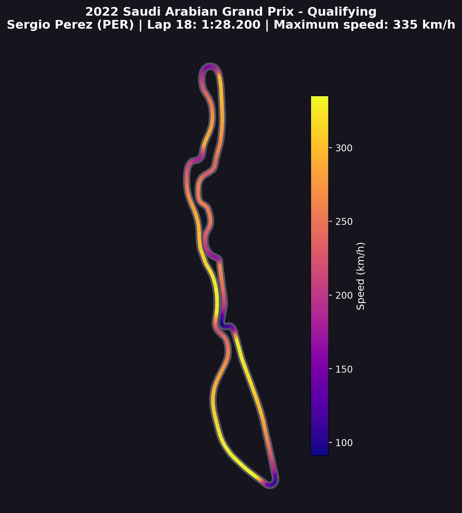
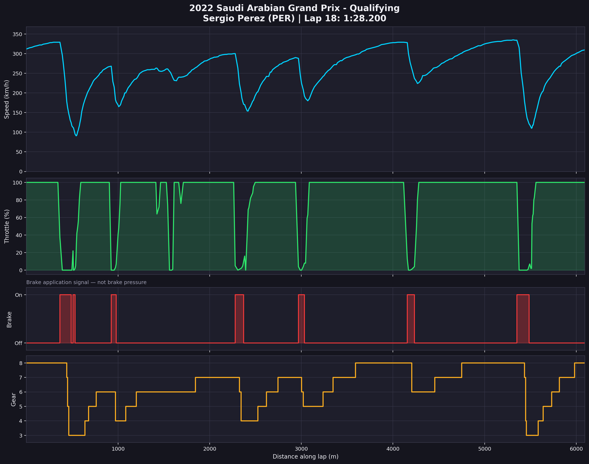
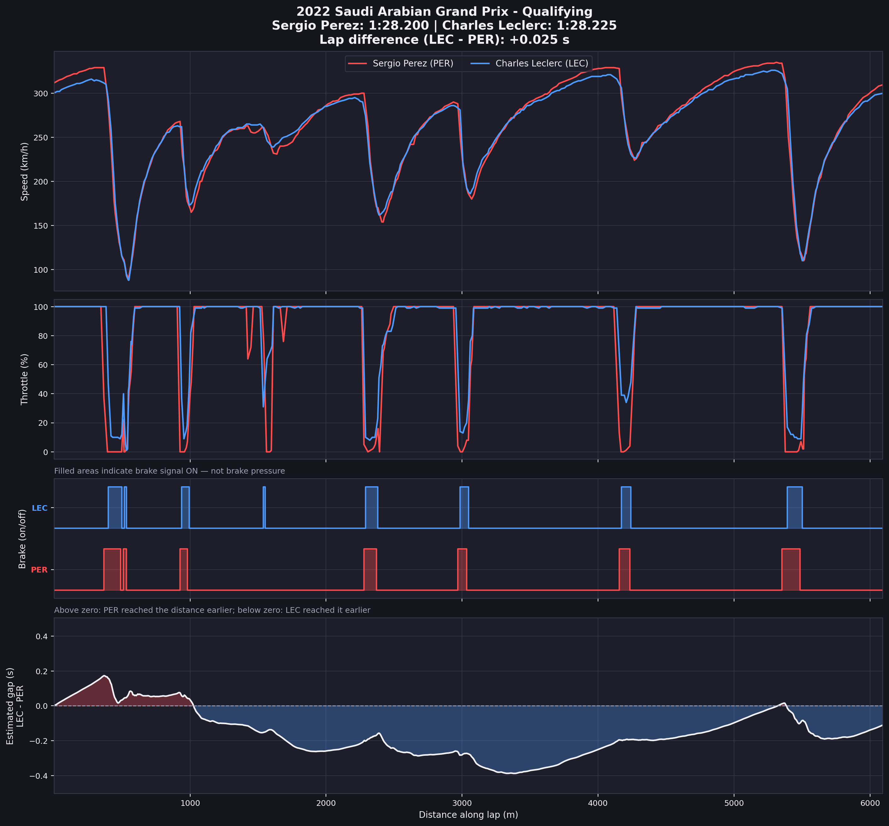

# 🏎️ F1 Telemetry Explorer

A Python-based Formula 1 data analysis project built with FastF1, Pandas, NumPy, and Matplotlib. Explore qualifying lap times, visualize circuit speed maps, analyze car telemetry, and compare drivers using real session data.

This project started as a single-race analysis and has evolved into a configurable notebook that can analyze different Grand Prix sessions.

## 🏁 Project Overview

## 🌐 Live Demo

**Try the interactive dashboard:** [Launch F1 Telemetry Explorer](https://f1-telemetry-explorer-a43zvpfwmhrydchs28qjxn.streamlit.app/)

Browse saved Formula 1 qualifying analyses from the 2022 Bahrain and Saudi Arabian Grands Prix, including circuit speed maps, car telemetry, and driver comparisons.


F1 Telemetry Explorer retrieves Formula 1 session data and turns it into visual insights about driver performance.

The project currently includes analysis from two 2022 qualifying sessions:

- **Bahrain Grand Prix:** Charles Leclerc's telemetry and Leclerc-versus-Verstappen comparison.
- **Saudi Arabian Grand Prix:** Automatic top-two driver selection and a Perez-versus-Leclerc comparison.

The configurable notebook allows the season, Grand Prix, and session to be changed from a shared configuration cell.

## ✨ Features

- **Qualifying Lap Analysis:** Display the ten fastest available individual laps.
- **Automatic Driver Selection:** Prefer the top two drivers in the session classification, with a fastest-lap fallback when classification data is unavailable.
- **Circuit Speed Maps:** Visualize the driver's recorded racing line, colored according to speed.
- **Telemetry Analysis:** Plot speed, throttle, brake application, and gear against distance.
- **Driver Comparison:** Compare speed, throttle, braking, lap times, and an estimated distance-aligned time-gap curve.
- **Race-Specific Image Saving:** Store each race and session's visualizations in a separate output folder.
- **Exportable Graphs:** Save visualizations as PNG images for reports and documentation.

## 📊 Visualizations

### 1. Bahrain Grand Prix — 2022 Qualifying

#### Circuit speed map

Visualizes Charles Leclerc's racing line using telemetry speed.


#### Telemetry analysis

Shows speed, throttle, brake application, and gear throughout Leclerc's selected lap.


#### Driver comparison

Compares Leclerc and Verstappen using their selected fastest qualifying laps.


### 2. Saudi Arabian Grand Prix — 2022 Qualifying

#### Circuit speed map

Visualizes Sergio Perez's selected qualifying lap after automatic driver selection.



#### Telemetry analysis

Displays the selected driver's speed, throttle, braking, and gear data.



#### Driver comparison

Compares Perez and Leclerc using their selected qualifying laps.



## 🛠️ Technologies Used

- **Python** — Main programming language
- **FastF1** — Formula 1 session, lap, and telemetry data
- **Pandas** — Data cleaning and table manipulation
- **NumPy** — Numerical calculations and interpolation
- **Matplotlib** — Circuit maps and telemetry visualizations
- **Google Colab** — Notebook development and execution
- **Git and GitHub** — Version control and project hosting

## 🚀 Getting Started

### Run the notebook in Google Colab

Open the notebook from GitHub:

[Open F1 Telemetry Explorer V2 in Google Colab](https://colab.research.google.com/github/meSudip028/F1-Telemetry-Explorer/blob/main/F1_Telemetry_Explorer_V2.ipynb)

Install the required packages in the first code cell:

```python
!pip install fastf1 pandas numpy matplotlib
```

Run the notebook from top to bottom:

1. Shared Configuration
2. Stage 1 — Lap Analysis
3. Stage 2 — Circuit Speed Map
4. Stage 3 — Telemetry Analysis
5. Stage 4 — Driver Comparison

If the Colab runtime restarts, run the installation and configuration cells again before running the analysis.

### Change the race and session

Edit the shared configuration cell near the top of the notebook:

```python
YEAR = 2022
EVENT_NAME = "Saudi Arabian Grand Prix"
SESSION_CODE = "Q"
```

Common session codes include:

- `FP1` — Practice 1
- `FP2` — Practice 2
- `FP3` — Practice 3
- `Q` — Qualifying
- `S` — Sprint
- `R` — Race

Availability varies by season and event format.

Set automatic driver selection to `True` to select the top two drivers from the session classification when available. If classification data is unavailable, the notebook can fall back to ranking drivers by their fastest timed laps.

Run Stage 1 after the configuration cell so the selected drivers are updated before running Stages 2–4.

## 📂 Project Structure

```text
F1-Telemetry-Explorer/
├── F1_Telemetry_Explorer.ipynb
├── F1_Telemetry_Explorer_V2.ipynb
├── README.md
├── requirements.txt
├── .gitignore
└── images/
    ├── 2022-bahrain-grand-prix-qualifying/
    │   ├── f1_circuit_speed_map.png
    │   ├── f1_telemetry_analysis.png
    │   └── f1_driver_comparison.png
    └── 2022-saudi-arabian-grand-prix-qualifying/
        ├── f1_circuit_speed_map.png
        ├── f1_telemetry_analysis.png
        └── f1_driver_comparison.png
```

## 📈 Understanding the Time-Gap Analysis

The driver comparison aligns each driver's telemetry to a common distance grid and estimates the elapsed-time difference at matching distances.

The result is an **estimate from sampled telemetry**, not an official FIA timing calculation. The drivers' fastest laps may have occurred at different times or under different conditions.

The actual difference between the selected lap times is reported separately.

The notebook also treats the Boolean brake channel as an on/off signal when applicable. It does not claim to measure brake pressure.

## 🎓 What I Learned

- Loading and exploring structured data using a Python library
- Cleaning missing and invalid telemetry values
- Analyzing data with Pandas and NumPy
- Building circuit and time-series visualizations with Matplotlib
- Comparing sampled time-series data using distance-based interpolation
- Refactoring code to use shared configuration settings
- Organizing outputs by event and session
- Preparing a Python project for GitHub

## 🔮 Future Improvements

- Build an interactive dashboard using Streamlit.
- Add dropdowns for season, Grand Prix, session, and driver selection.
- Support browsing and comparing multiple races from an interactive interface.
- Improve lap validation and time-gap analysis.
- Deploy a public web application.

## ⚠️ Data and Disclaimer

This is an independent educational project and is not affiliated with Formula 1, the FIA, or any Formula 1 team.

Data availability depends on FastF1, the upstream data sources, internet access, and any applicable authentication requirements.

Formula 1 names and related marks belong to their respective owners.

---

**Built with Python and a passion for Formula 1. 🏁**
