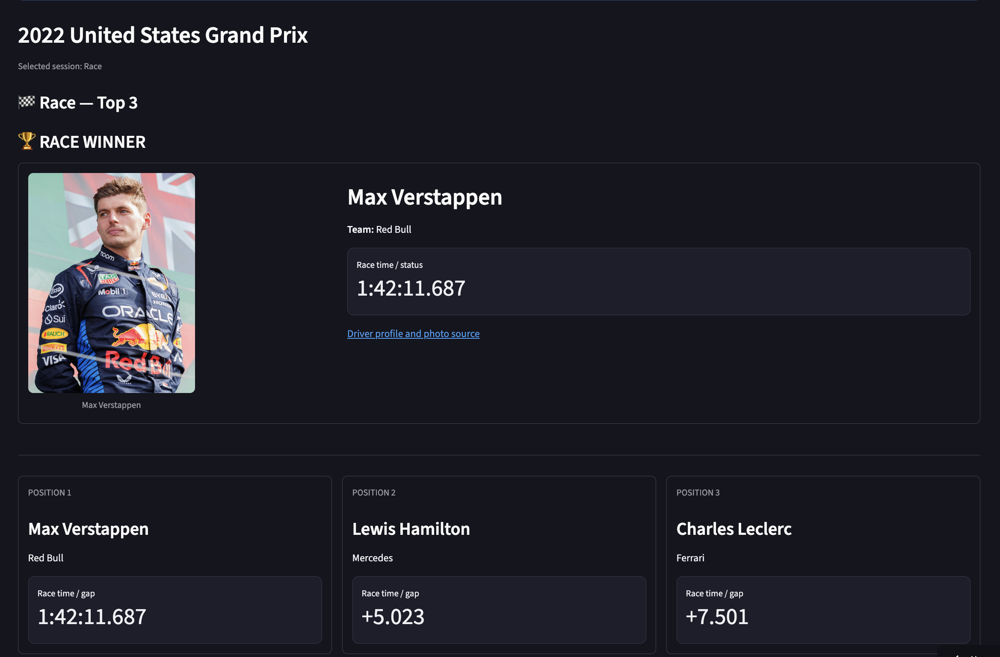
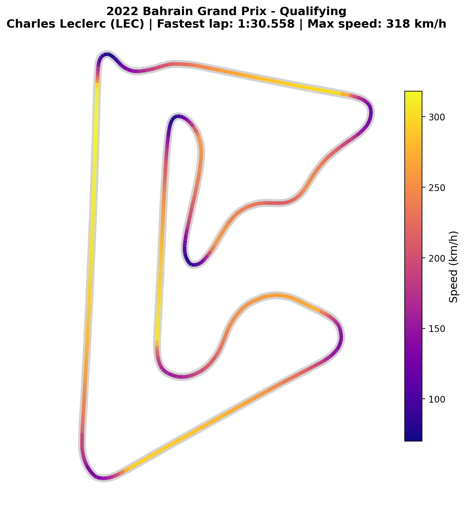
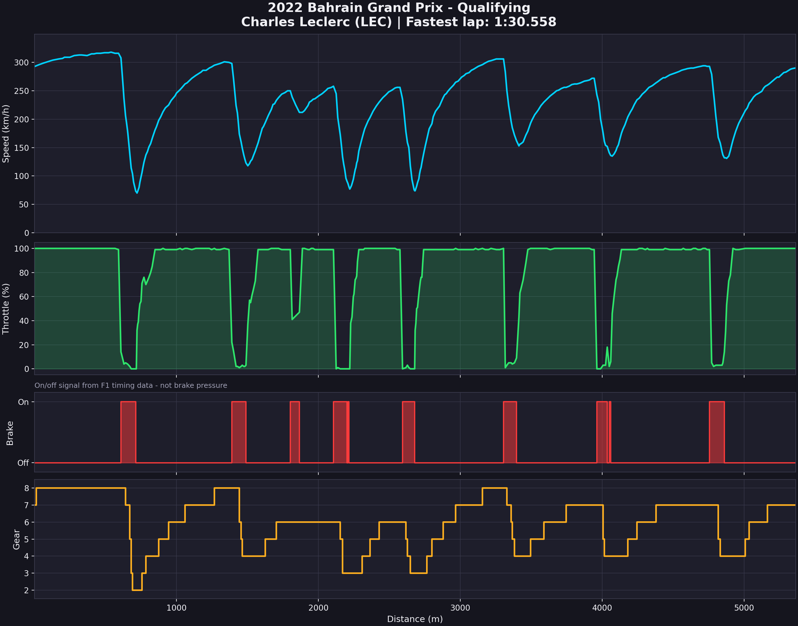
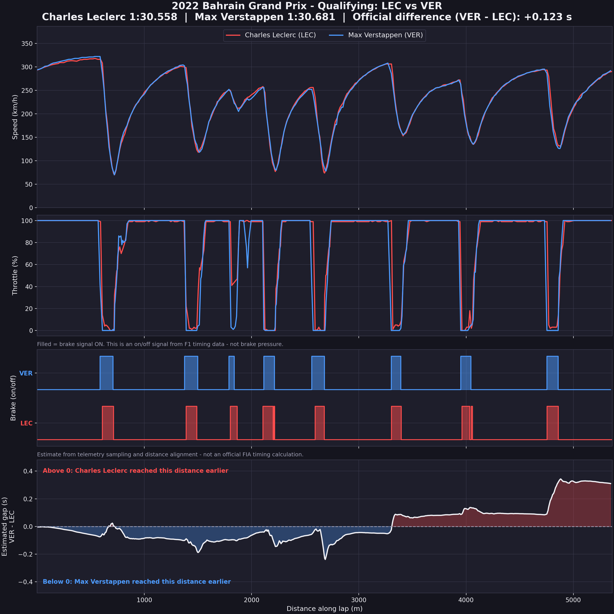
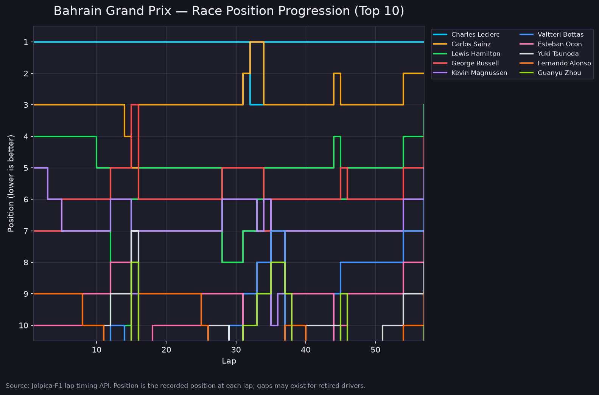
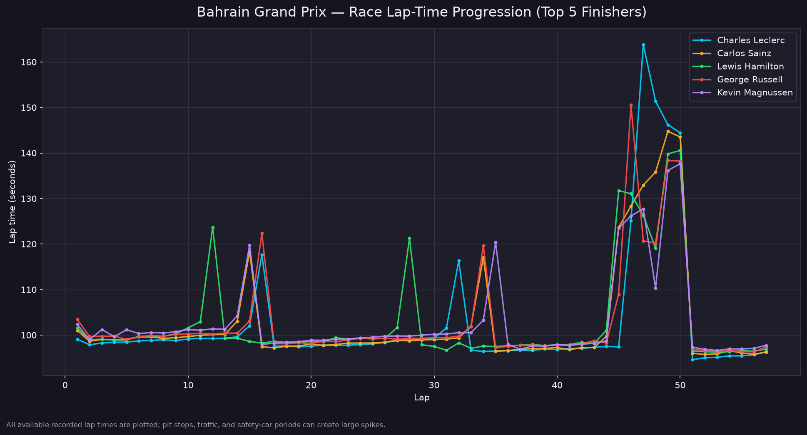
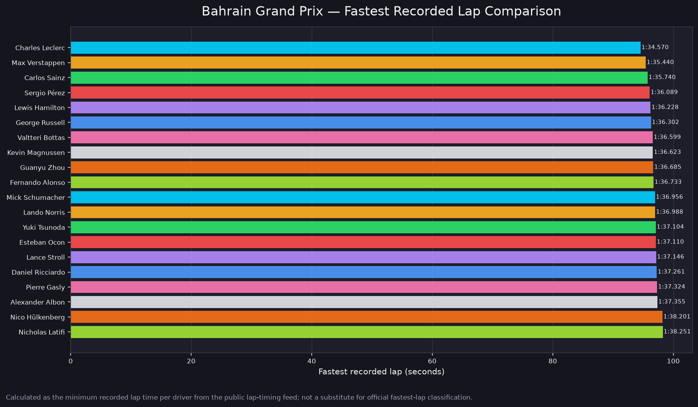

# 🏎️ F1 Telemetry Explorer

An interactive Formula 1 data analysis project built with Python. Explore the **complete 2022 F1 season** through qualifying telemetry, race lap-time analysis, driver comparisons, and session results.

### 🖥️ Live Dashboard Preview



🌐 **[Try the Live Dashboard](https://f1-telemetry-explorer-a43zvpfwmhrydchs28qjxn.streamlit.app/)**

---

## 🏁 Project Overview

### 🖥️ Live Dashboard Preview


🌐 **[Try the Live Dashboard](https://f1-telemetry-explorer-a43zvpfwmhrydchs28qjxn.streamlit.app/)**

F1 Telemetry Explorer is a Streamlit dashboard for exploring the 22 Grands Prix of the 2022 Formula 1 season.

Choose a Grand Prix, switch between **Qualifying** and **Race**, view the top three drivers, and explore the corresponding visualizations.

The project combines FastF1 telemetry analysis with public race timing and classification data.

## ✨ Features

- **Full 2022 Season:** Explore all 22 Grands Prix.
- **Session Selector:** Switch between Qualifying and Race.
- **Top-Three Results:** View driver names, teams, qualifying times, and race results.
- **Winner Spotlight:** Highlight the pole sitter or race winner, with a driver photo when available.
- **Circuit Speed Maps:** Visualize recorded racing lines using speed data.
- **Car Telemetry:** Analyze speed, throttle, braking, and gear from qualifying laps.
- **Driver Comparison:** Compare selected qualifying laps using telemetry and an estimated time-gap curve.
- **Race Position Progression:** Explore how driver positions change throughout a race.
- **Race Lap-Time Progression:** Compare recorded lap times during a race.
- **Fastest-Lap Comparison:** Compare drivers' fastest recorded race laps.
- **PNG Downloads:** Download charts for further analysis or documentation.

## 📊 Visual Examples

### Qualifying — Bahrain Grand Prix, 2022

**Circuit speed map**



**Speed, throttle, brake, and gear analysis**



**Driver comparison**



### Race — Bahrain Grand Prix, 2022

**Race position progression**



**Race lap-time progression**



**Fastest recorded lap comparison**



## 🧪 Data Sources and Accuracy

The dashboard uses different data sources for its different visualizations.

| Analysis | Data source | What it shows |
|---|---|---|
| Qualifying telemetry | FastF1 | Speed, throttle, brake, gear, and circuit position where available |
| Qualifying results | Public results API | Qualifying classification and lap times |
| Race results | Public results API | Finishing positions, race times, and gaps where available |
| Race charts | Public lap timing and classification data | Lap-time progression, positions, and fastest recorded laps |

**Important distinction:** The Race charts are based on public lap timing and classification data. They are not high-frequency car telemetry and do not contain the same speed, throttle, brake, gear, or GPS data as the qualifying telemetry charts.

The driver-comparison time-gap curve is an estimate derived from sampled telemetry aligned by distance. It is not an official FIA timing calculation.

Driver photos may not be available for every driver.

## 🛠️ Technologies Used

- **Python** — Main programming language
- **FastF1** — Formula 1 session and telemetry analysis
- **Streamlit** — Interactive web dashboard
- **Jolpica-F1 API** — Public race results and lap timing
- **Pandas** — Data processing
- **NumPy** — Numerical calculations and interpolation
- **Matplotlib** — Data visualization
- **Git and GitHub** — Version control and project hosting

## 🚀 Run Locally

### 1. Clone the repository

```bash
git clone https://github.com/meSudip028/F1-Telemetry-Explorer.git
cd F1-Telemetry-Explorer
```

### 2. Create and activate a virtual environment

```bash
python -m venv .venv
source .venv/bin/activate
```

### 3. Install dependencies

```bash
python -m pip install -r requirements.txt
```

### 4. Start the dashboard

```bash
streamlit run app_full.py
```

Open the local address displayed in your terminal.

The saved-analysis gallery can display the committed charts without downloading the entire season's telemetry again. Loading new live FastF1 sessions may have additional data-access or authentication requirements.

## 📂 Project Structure

```text
F1-Telemetry-Explorer/
├── F1_Telemetry_Explorer.ipynb
├── F1_Telemetry_Explorer_V2.ipynb
├── app_full.py
├── requirements.txt
├── README.md
└── images/
    ├── 2022-bahrain-grand-prix-qualifying/
    ├── 2022-bahrain-grand-prix-race/
    ├── 2022-united-states-grand-prix-qualifying/
    ├── 2022-united-states-grand-prix-race/
    └── ...remaining 2022 Grand Prix sessions
```

The `images/` directory stores the saved analyses by Grand Prix and session.

## 🎓 What I Learned

- Working with structured data through Python libraries and APIs.
- Processing lap times, driver results, and telemetry data.
- Creating circuit maps and time-series visualizations.
- Comparing drivers using sampled data and distance-based interpolation.
- Building an interactive Streamlit application.
- Handling missing data, caching, and data-access failures.
- Automating the generation of charts for an entire racing season.
- Managing project versions and deploying an application through GitHub.

## 🔮 Future Improvements

- Expand the explorer to additional Formula 1 seasons.
- Add automated tests for data processing and result validation.
- Improve chart performance, accessibility, and error handling.
- Expand session-specific comparisons wherever reliable data is available.

## ⚠️ Disclaimer

This is an independent educational project and is not affiliated with Formula 1, the FIA, or any Formula 1 team.

Data availability and accuracy depend on the upstream data sources and their access policies. Public race timing charts should not be interpreted as official telemetry measurements.

Formula 1 names and related marks belong to their respective owners.

---

**Built with Python and a passion for Formula 1. 🏁**
